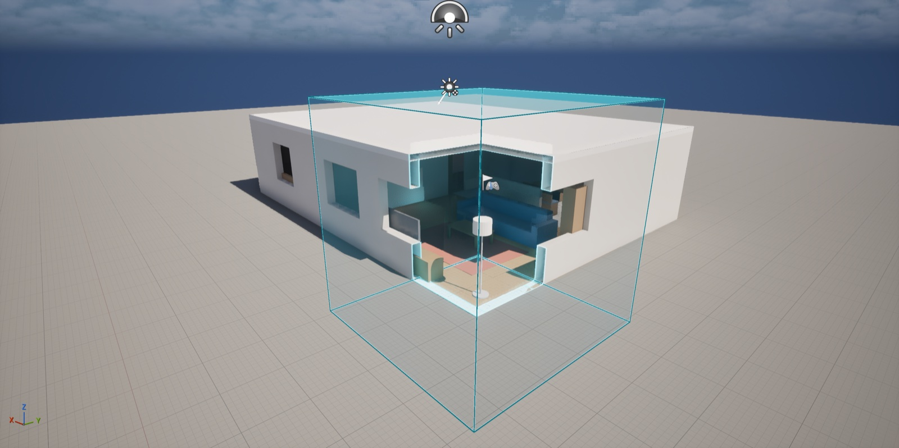
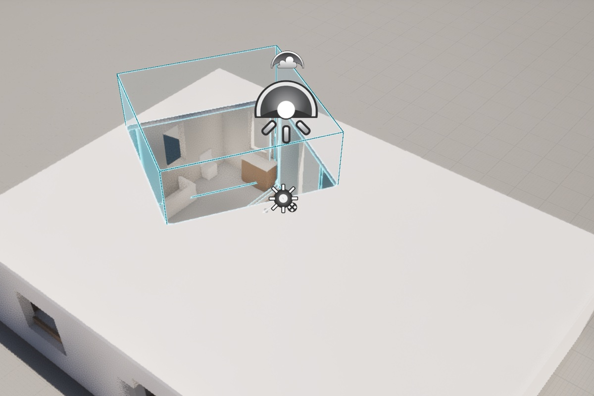

# X-Ray Cube

An Unreal Engine 5 plugin for **compute-shader cut-away volumes**: drop a cube
into a building, move it around, and every wall and ceiling inside the cube
disappears so you can see through the apartment.



Built in the same low-level style as
[GPULab](https://github.com/MatinEsmaeili00/GPULab) and
[SnowDeformation](https://github.com/MatinEsmaeili00/SnowDeformation)
(`FGlobalShader` + `SHADER_PARAMETER_STRUCT` + RDG + `ENQUEUE_RENDER_COMMAND`,
a world subsystem, ping-pong persistent state), taken from a 2D height field
to a **3D signed distance field**.

Developed against **UE 5.8** on macOS (Metal SM6). Status and next steps:
[TODO.md](TODO.md).

## Quick start

1. Copy (or clone) this folder to `<YourProject>/Plugins/XRayCube`. Your
   project needs to be a C++ project, or build the plugin once from a C++ one.
2. Open the project; the plugin compiles and is enabled by default.
3. Open **`/XRayCube/Maps/XRayDemo`** (Content Browser › *Plugins* ›
   *XRayCube Content* › *Maps*; turn on *Show Plugin Content* if you don't see it).
4. Select the **XRayCube** actor and drag it around. The cut follows it live in
   the editor viewport. Scale it, rotate it, add more. Press **Play** and it
   works the same in game.

To use it in your own level: give your walls an instance of
**`M_XRayCutaway`** (or add its Custom node to your materials, see
[Material wiring](Docs/05-material-wiring.md)), then place an
**X Ray Cube Actor**, or add an **X-Ray Cutter** component to any actor.



## How it works

```
UXRayCutterComponent (a UBoxComponent; AXRayCubeActor has one as its root)
        │  OnRegister → registers with the world's subsystem (editor and game)
        ▼
UXRayCubeSubsystem::Tick()   (game thread, once per world per frame)
        │  1. pull every cutter's oriented box
        │  2. centre the field on them, snapped to whole voxels
        │  3. convert to field-local FXRayCutterGPU (64 bytes each)
        │  4. skip entirely if nothing moved and the field has settled
        │  5. ENQUEUE_RENDER_COMMAND → XRayCube::Dispatch_RenderThread
        │  6. push XRayFieldCenter / XRayFieldSize into the MPC
        ▼
XRayCube.usf (render thread, GPU, 4×4×4 thread groups, one voxel each)
        │  Pass 1 XRayFieldUpdateCS:   reproject last frame's volume (integer
        │         voxel shift), evaluate exact oriented-box SDFs, smooth-union
        │         them, ease the stored field towards the result
        │  Pass 2 XRayFieldGradientCS: distance → RGBA16F (R = distance,
        │         GBA = direction out of the cut)
        ▼
RTV_XRayField (volume render target) → any material using XRayCubeMaterial.ush
        OpacityMask = distance > 0, Emissive = glow near distance ≈ 0
```

The material does **one** 3D texture fetch per pixel no matter how many cubes
there are. The compute shader does the per-cutter work once per voxel, and only
when something has changed.

## Documentation

| | |
|---|---|
| [1. Architecture](Docs/01-architecture.md) | why a 3D distance field, scrolling + voxel snapping, the idle skip |
| [2. GPU compute pipeline](Docs/02-gpu-compute-pipeline.md) | RDG passes, UAVs on volume RTs, 3D thread groups |
| [3. Shader walkthrough](Docs/03-shader-walkthrough.md) | box SDF, smooth union, reprojection, easing, gradient |
| [4. C++ reference](Docs/04-cpp-reference.md) | every class, Blueprint API, lifecycle |
| [5. Material wiring](Docs/05-material-wiring.md) | Custom node + include, LWC, making materials cuttable |
| [6. Apartment & Blender](Docs/06-apartment-blender.md) | the procedural apartment, units/axes, importing |
| [7. Tuning & troubleshooting](Docs/07-tuning-troubleshooting.md) | voxel size, response, every warning explained |

## Layout

```
XRayCube/
├── XRayCube.uplugin
├── Shaders/Private/XRayCube.usf            - XRayFieldUpdateCS, XRayFieldGradientCS
├── Shaders/Private/XRayCubeMaterial.ush    - material-side helpers (Custom node include)
├── Source/XRayCube/
│   ├── Public/XRayCubeComputePass.h        - FXRayCutterGPU, dispatch params, shader classes
│   ├── Private/XRayCubeComputePass.cpp     - shader registration + RDG dispatch
│   ├── Public/XRayCubeSettings.h           - Project Settings > Plugins > X-Ray Cube
│   ├── Public/XRayCubeSubsystem.h          - UTickableWorldSubsystem that owns the field
│   ├── Public/XRayCutterComponent.h        - box component that cuts
│   └── Public/XRayCubeActor.h              - the cube: cutter + glass mesh (+ follow-camera mode)
├── Content/
│   ├── Materials/                          - RTV_XRayField, MPC_XRayField, M_XRayCutaway, M_XRayCube
│   ├── Apartment/                          - SM_Apartment_* meshes + MI_* surface instances
│   └── Maps/XRayDemo                       - demo level
├── Art/Apartment.fbx, Apartment.blend      - demo apartment source art
├── Tools/Blender/build_apartment.py        - regenerates the apartment procedurally
├── Tools/ShaderCheck/                      - offline DXC compile of every shader entry point
└── Docs/                                   - deep-dive documentation
```

## License

Copyright Matin. All rights reserved.
